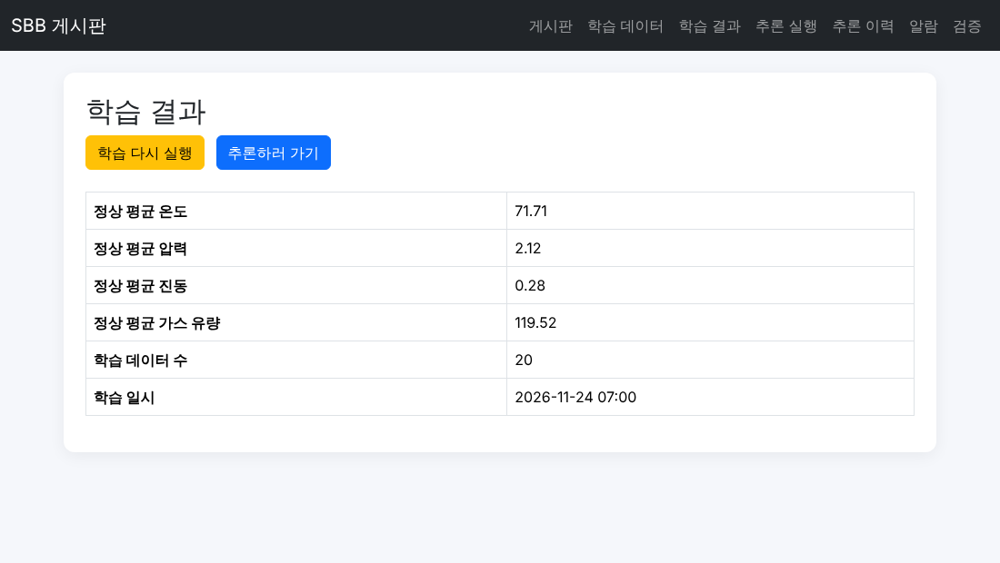
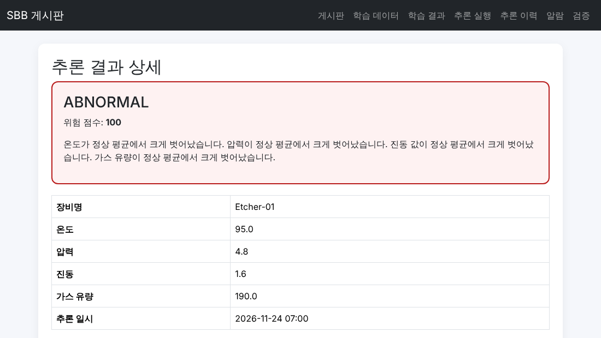
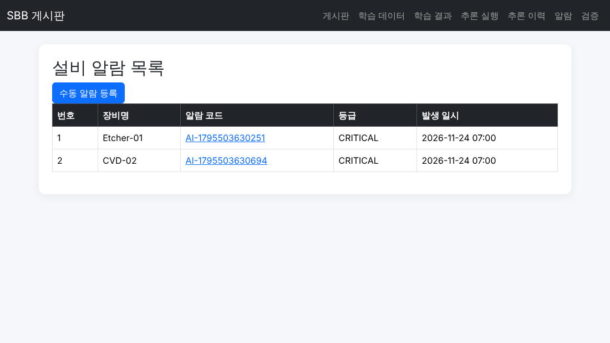
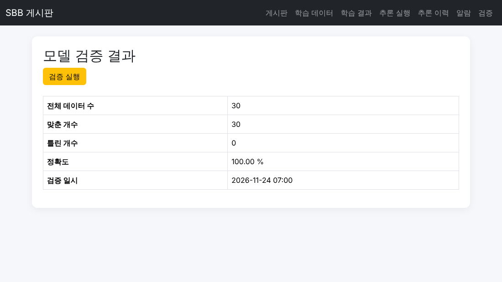

# SBB - 장비 이상 판정·알람 데모

Spring Boot 수업의 SBB 게시판(Q&A)에 **센서값으로 장비 이상을 판정하고 알람을 남기는 흐름**을 붙인 프로젝트입니다. 학습 데이터 만들기 → 학습 → 판정 → 자동 알람 → 피드백 → 검증까지 상단 메뉴 순서대로 따라가며 볼 수 있습니다.

화면 메뉴에는 "학습", "추론"이라는 이름을 쓰지만, 머신러닝 모델은 아닙니다. 정상 데이터의 **평균값**을 기준으로 삼고, 새 센서값이 그 평균에서 얼마나 벗어났는지를 **정해진 규칙**으로 점수화합니다(아래 [판정 방식](#판정-방식)).

| 학습 결과 (정상 평균) | 판정 결과 |
| --- | --- |
|  |  |

| 자동 알람 | 검증 |
| --- | --- |
|  |  |

## 흐름

| 순서 | 메뉴 | 하는 일 |
| --- | --- | --- |
| 1 | 학습 데이터 (`/sensor/list`) | 장비명, 온도, 압력, 진동, 가스 유량, 라벨(NORMAL/ABNORMAL)을 직접 입력하거나 **샘플 데이터 생성**으로 정상 20건 + 이상 10건을 만듦 |
| 2 | 학습 실행 → 학습 결과 (`/model/info`) | NORMAL 라벨 데이터의 항목별 평균을 "모델"로 저장하고 보여 줌 |
| 3 | 추론 실행 (`/predict/form`) | 새 센서값을 넣으면 위험 점수(0~100)와 NORMAL/ABNORMAL, 판정 사유를 보여 줌. 결과에 "정확함/부정확함" 피드백과 메모를 남길 수 있음 |
| 4 | 알람 (`/alarm/list`) | ABNORMAL이면 `AI-…` 코드의 CRITICAL 알람이 자동으로 생김. 수동 알람 등록, 조치 메모 기록 |
| 5 | 검증 (`/validation/result`) | 저장된 학습 데이터 전체를 다시 판정해 라벨과 맞은 비율(정확도)을 계산 |

게시판(질문 목록·상세·작성·수정·삭제, 답변 등록)은 수업 SBB 그대로입니다.

학습 전에 추론·검증을 하거나 정상 데이터 없이 학습하면, 무엇을 먼저 해야 하는지 알려 주는 안내 화면이 나옵니다.

## 판정 방식

학습된 정상 평균과 입력값의 차이가 허용 범위를 **넘으면** 그 항목의 가중치를 점수에 더합니다.

| 항목 | 허용 범위 (정상 평균과의 차이) | 가중치 |
| --- | --- | --- |
| 온도 | ±15 | 30 |
| 압력 | ±1.5 | 25 |
| 진동 | ±0.8 | 25 |
| 가스 유량 | ±40 | 20 |

- 합산 점수 **20점 이상** → `ABNORMAL`, 그 미만(0점) → `NORMAL`. 즉 한 항목이라도 범위를 벗어나면 이상입니다.
- 점수는 벗어난 항목의 가중치 합(0~100)이라, 몇 개 항목이 벗어났는지와 어느 항목인지를 함께 보여 줍니다.
- 규칙은 `predict/RiskRule.java` 한 곳에 있고, 추론과 검증이 같은 규칙을 씁니다.

**검증 정확도에 대해**: 검증은 학습에 쓴 데이터를 그대로 다시 판정합니다. 샘플 데이터는 정상(온도 65~80 등)과 이상(온도 90~105 등)이 처음부터 겹치지 않게 만들어지므로 정확도가 항상 100%로 나옵니다. 판정 규칙이 맞게 동작하는지 확인하는 용도이고, 처음 보는 데이터에 대한 성능을 뜻하지는 않습니다.

## 기술 스택

| 항목 | 기술 |
| --- | --- |
| 언어 | Java 17 |
| 프레임워크 | Spring Boot 4.0.3 (Spring MVC, Spring Data JPA) |
| DB | H2 (파일 `~/local`) |
| 화면 | Thymeleaf, Bootstrap |
| 빌드 | Gradle |
| 기타 | Lombok, DevTools |

## 실행 방법

JDK 17이 필요합니다.

```bash
# Windows
gradlew.bat bootRun

# macOS / Linux
sh ./gradlew bootRun
```

서버는 이 PC에서만 접속할 수 있게 `127.0.0.1:8080`으로 열립니다(`application.properties`의 `server.address`). 로그인 기능이 없으므로 다른 기기에 열어 두지 않는 것을 권합니다.

- 메인(게시판): http://localhost:8080/
- H2 콘솔: http://localhost:8080/h2-console
  - JDBC URL `jdbc:h2:~/local`, 사용자 `sa`, 비밀번호 없음

처음 실행하면 데이터가 비어 있습니다. 상단 **학습 데이터** 메뉴에서 **샘플 데이터 생성** → **학습 실행**을 누른 뒤 **추론 실행**으로 가 보세요.

## 테스트

```bash
gradlew.bat test        # Windows
sh ./gradlew test       # macOS / Linux
```

테스트는 메모리 DB를 써서 개발 DB(`~/local`)를 건드리지 않습니다.

| 테스트 | 확인하는 것 |
| --- | --- |
| `RiskRuleTest` | 항목별 단독 이상, 경계값, 0점·100점 |
| `PipelineIntegrationTest` | 샘플 생성 → 학습 → 판정 → 검증 흐름 |
| `SafetyIntegrationTest` | 학습 전 요청 안내 화면, 질문 삭제는 POST로만 |
| `SbbApplicationTests` | 질문 저장·조회 |

## 프로젝트 구조

```
src/main/java/com/mysite/sbb/
├── sensor/         학습 데이터(센서값), 샘플 생성
├── model/          학습(정상 평균 계산), 학습 결과
├── predict/        판정 규칙(RiskRule), 판정 결과, 피드백
├── alarm/          장비 알람(자동·수동), 조치 메모
├── validation/     검증(정확도 계산)
├── question/       게시판 질문
├── answer/         게시판 답변
└── SbbApplication.java
```

## 주소 요약

| 경로 | 설명 |
| --- | --- |
| `/question/list` | 질문 목록 |
| `/sensor/list` | 학습 데이터 목록 |
| `/sensor/generate` | 샘플 데이터 생성 (정상 20 + 이상 10) |
| `/model/train` | 학습 실행 |
| `/model/info` | 학습 결과 |
| `/predict/form` | 판정 입력 |
| `/predict/run` | 판정 실행 (POST) |
| `/predict/list` | 판정 이력 |
| `/alarm/list` | 알람 목록 |
| `/validation/run` | 검증 실행 |
| `/validation/result` | 검증 결과 |
